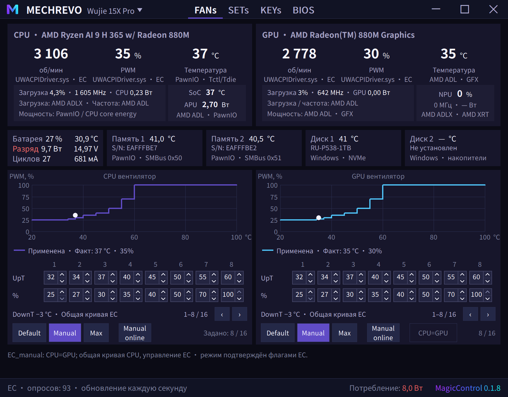

# MagicControl

MagicControl — программа для мониторинга и управления ноутбуками и мини-ПК под **Windows 11 x64** и **Linux x64**. Поддержка функций зависит от конкретной платы, прошивки, операционной системы и доступных драйверов.

**Автор: NikiMagic · актуальная версия: 0.1.483**

## Скачать и запустить

Готовые portable-архивы и контрольные суммы: **[MagicControl 0.1.483 — Releases](https://github.com/nikimagic/MagicControl/releases/tag/v0.1.483)**.

| Система | Архив | Запуск |
|---|---|---|
| Windows 11 x64 | [Windows ZIP](https://github.com/nikimagic/MagicControl/releases/download/v0.1.483/MagicControl-0.1.483-windows-x64-portable.zip) | Распакуйте архив целиком и запустите `MagicControl.exe`. |
| Linux x64 | [Linux TAR.GZ](https://github.com/nikimagic/MagicControl/releases/download/v0.1.483/MagicControl-0.1.483-linux-x64-portable.tar.gz) | Распакуйте архив целиком и запустите `./start.sh`. |

Проверка загрузки: [SHA256SUMS.txt](https://github.com/nikimagic/MagicControl/releases/download/v0.1.483/SHA256SUMS.txt). При ручном обновлении сохраняйте свои `settings/`, журналы и дампы. Linux-пакет — portable с системными зависимостями, не AppImage; требования приведены внутри архива.

## Поддерживаемые устройства

В программе 18 именованных профилей и режим **Unknown**. Распознавание модели и наличие её в меню не означают, что все команды на ней доступны. Доступность каждой функции определяется фактической платой, ОС, прошивкой, драйвером и проверкой состояния.

### Подключённые профили

| Устройство / плата | Возможности и особенности |
|---|---|
| **MECHREVO Wujie 15X Pro · X5SP4NAG** | Windows: вентиляторы, мощность APU, батарея, подсветка и модельная телеметрия. Вкладка OvClock показывает доступные данные прошивки. |
| **MECHREVO JiguangX · GM6IR0C** | Windows: модельные пути вентиляторов, мощности CPU, батареи и подсветки. |
| **MECHREVO Yilong15Pro · GM5HG0A** | Windows: модельные пути вентиляторов, мощности APU, батареи и подсветки. |
| **MACHENIKE L16 S · L16** | Windows: модельные пути вентиляторов, мощности APU, батареи и подсветки. |
| **Honor MagicBook Pro · HLYL-WXX9** | Собственный HWMI/I2EC-путь Windows; белая подсветка и модельные функции батареи. В Linux поддержанные функции используют доступный `huawei-wmi`/sysfs. |
| **Eluktronics HYDROC-16 G2 · HYDROC-16** | Отдельный профиль Uniwill и диагностика; доступность функций зависит от модели, прошивки и оборудования. Поддержка внешней СЖО зависит от обнаружения и доступного пути управления. |
| **MINISFORUM EliteMini · HPBSD** | Windows: мониторинг, управление CPU/системным вентилятором и поддерживаемые режимы мощности. Батареи и подсветки клавиатуры у этого профиля нет. |
| **Lenovo Legion · KWCN / LNVNB161216** | Windows: модельные пути WMI/EC для вентиляторов, мощности, батареи и белой подсветки; доступны расширенные диагностические журналы. Фактические функции проверяются на устройстве. |

Подключённый путь не означает физическую проверку каждой комбинации BIOS и режима. Например, штатные таблицы FAN Honor доступны для просмотра, но запись произвольной штатной таблицы не объявляется подтверждённой.

### Профили распознавания и просмотра

Для перечисленных моделей каталог содержит сведения о модели; аппаратное управление только на основании этого профиля не включается:

| Производитель | Модель / плата |
|---|---|
| MECHREVO | Kuangshi16 Super · GM6PX7X |
| MECHREVO | Kuangshi · X6xx55xW-B2 |
| MECHREVO | Canglong · X6xR55xY |
| MECHREVO | Jiaolong16K · GM6BG0X |
| MECHREVO | Jiguang · X6xx57TW |
| MECHREVO | Jiaolong · X6DR55xx-B2 |
| MECHREVO | Huan 16 Air · GX6HG0U-F |
| MECHREVO | Canglong · X8xR55xP-B2 |
| MECHREVO | Yaoshi · X6AR55xY |
| MECHREVO | Yaoshi16Super · GM6IX9B |

**Unknown:** INFO и системные функции доступны и для нераспознанного устройства; подходящие системные датчики можно читать по фактической доступности. Чужая карта EC к такому устройству не применяется. Выбор другой модели в меню позволяет просматривать её интерфейс и не выдаёт аппаратных прав.

## Основные функции

- **FANs:** мониторинг температур, оборотов и доступного PWM; штатные графики и режимы Default, Manual, Max и Manual online там, где они поддержаны. Общий редактор хранит до 16 точек на канал; число точек и аппаратный формат задаются устройством.
- **SETs / мощность:** штатные профили устройства, общий Custom с тремя пресетами, редактирование доступных CPU/APU/GPU-лимитов и сохранение настроек. Доступные диапазоны и фактическое применение зависят от прошивки и контроллера.
- **Батарея:** показ данных EC и ОС с указанием источника: заряд, ток, мощность, температура, напряжение, ёмкость, здоровье, циклы и дата изготовления — если источник сообщает их.
- **Подсветка:** поддерживаемые устройством режимы клавиатуры, цвета и яркость; белая подсветка Honor и Lenovo использует свои режимы.
- **KEYs и INFO:** поддерживаемые функции клавиш, системные переключатели, сведения о железе, драйверах, BIOS и дисплее. Неподключённые функции остаются недоступными.
- **GPU и датчики:** доступные NVIDIA, AMD и Intel источники; температуры памяти и накопителей при наличии датчиков и совместимого транспорта. Неизвестные показания не подменяются нулями.
- **Интерфейс:** русский, английский, упрощённый и традиционный китайский; трей, OSD и проверка обновлений. Настройки хранятся в `settings/` рядом с программой.

Linux использует доступные интерфейсы ОС и модельные backend. Windows-драйверы и их команды на Linux не переносятся. Управление конкретной функцией доступно только при наличии её Linux-пути.

### Ограничение и обход зарядки

- **Процентный верхний предел:** кнопки `100% / 95% / 85% / 60%` доступны при наличии соответствующего модельного пути. В зависимости от устройства используются разные штатные или модельные механизмы. Успешная запись и readback настройки не доказывают фактическую остановку тока.
- **Нижний порог:** для введённого значения пока не подтверждён универсальный механизм возобновления заряда; работа пары **95/90** при закрытой программе не заявляется доказанной.
- **Wujie · «Обход»:** экспериментальный модельный режим подмены расчётного возраста и счётчика термоистории в EC. Исходные значения и подтверждённые последующие приросты сохраняются для восстановления; настоящая дата изготовления и циклы выводятся отдельно. Функция допущена только для точно проверенной Windows-конфигурации Wujie. Она влияет на расчёт прошивки и может изменить целевое напряжение зарядки; физическую ёмкость батареи не восстанавливает.
- **«Термочасы»:** при наличии данных показывается накопленная термоистория, включая подтверждённое накопление во время обхода. Это единицы термоэкспозиции прошивки, а не доказанное количество обычных часов работы. Исходные файлы истории и `settings/` необходимо сохранять при обновлении.

## Драйверы и инструменты чтения прошивки

В Windows-версию встроены оригинальные компоненты, используемые при подтверждённой совместимости:

| Компонент | Назначение |
|---|---|
| **PawnIO 2.2.0** | Официальный установщик и модули мониторинга/доступа, включая AMD и Intel. Модулям нужен установленный драйвер PawnIO. |
| **Uniwill UWACPIDriver** `10.48.11.331` и `11.2.18.347` | Отдельные OEM-пакеты ACPI для соответствующих устройств; версия выбирается по совместимости, а не как универсальное обновление. |
| **Lenovo Energy Management / AcpiVpc** `15.11.29.70` | Штатный пакет Lenovo для поддерживаемого Legion; версия установленного драйвера определяется на устройстве. |
| **AMI AFUWIN** `5.17.00.0153` | Чтение системной прошивки на совместимых AMI-системах. |
| **Intel FPT** `16.1.27.2181` и `19.0.5.1948` | Чтение на подходящих Intel-платформах после проверки совместимости. |
| **Insyde H2OFFT** `6.76` | Чтение на подходящих Insyde-системах после проверки интерфейса и совместимости. |
| **NVIDIA NVFlash** `5.867.0` | Чтение поддерживаемой NVIDIA VBIOS/EEPROM. Linux-пакет также содержит Linux NVFlash reader. |

Установка драйвера не выполняется автоматически при запуске; используйте соответствующее действие в INFO. Наличие встроенного инструмента не гарантирует его работу с каждой платой и не означает обход защиты ОС. Компоненты AMD, Intel и NVIDIA, поставляемые с графическим драйвером, отдельно в пакет не включены.

В INFO доступны сбор сведений и отдельные действия для **EC, BIOS и VBIOS**. Возможность и полнота чтения зависят от устройства, reader и разрешений прошивки; размер файла сам по себе не доказывает полноту всех регионов. На поддерживаемых устройствах диагностический сценарий может временно переключать вентиляторы и затем восстанавливать подтверждённый режим. Linux не содержит общего системного BIOS-reader AFU/FPT.

## Лицензия и обратная связь

Copyright (c) 2026 NikiMagic. All rights reserved. MagicControl распространяется по [Proprietary Binary License](LICENSE.txt); исходный код собственных компонентов не публикуется. Лицензии, уведомления и предложение исходников соответствующих сторонних компонентов находятся внутри пакетов. Для встроенных OEM-компонентов действуют условия их правообладателей; отдельное разрешение на публичное распространение Uniwill OEM-драйвера пока не подтверждено.

При сообщении о проблеме укажите модель, плату, версию BIOS, ОС и версию MagicControl. Не публикуйте серийные номера, ключи и другие личные данные.

